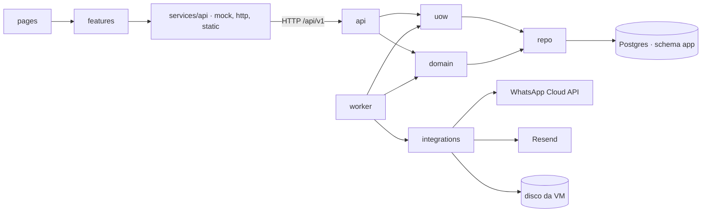
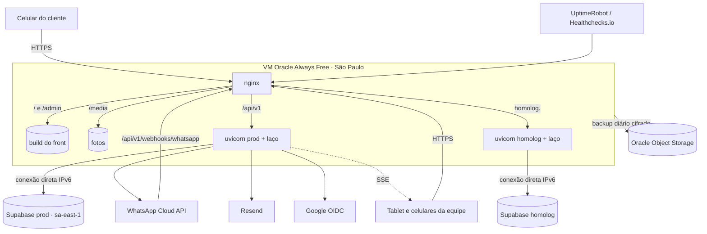
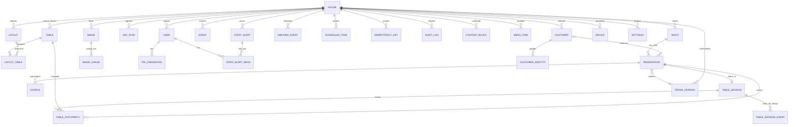

# Arquitetura · Território, Módulo 1

## Paradigma

**Backend:** camadas com adaptadores nas bordas. A regra de negócio fica no meio e não conhece HTTP, banco nem WhatsApp. Acesso ao banco síncrono, SQL escrito à mão, sem ORM.

**Front:** camadas `tokens → components → features → pages`, com uma única porta para a API (`src/services/api/`). Tokens, components e pages já existem; a reserva vive em `src/pages/reservar.js`, e `features/` começa com o painel da equipe, com a regra de import do ESLint já pronta. O painel é uma aplicação própria em `src/admin/`, com as mesmas camadas e a mesma porta de API.

| Camada (backend) | Pasta | Pode usar |
| --- | --- | --- |
| Rotas HTTP | `server/app/api/` | `domain`, `auth`, `uow` |
| Regras | `server/app/domain/` | os repositórios que a UoW entrega; nada de FastAPI, httpx, psycopg ou SQL |
| Acesso ao banco | `server/app/repo/` | psycopg 3 (SQL à mão) |
| Transação | `server/app/uow.py` | `psycopg_pool`, `repo` |
| Adaptadores | `server/app/integrations/` (`whatsapp`, `email`, `storage`, `google`, `alerts` = Sentry) | httpx |
| Laço de tarefas | `server/app/worker/` | `domain`, `integrations`, `uow` |



## Invariantes e regras

### AD-1 — Uma porta para a API no front [ADOPTED]

- **Binds:** todo o front.
- **Prevents:** telas chamando URLs diferentes, o mock e a API real divergindo por tela, ou telas testando o modo da API.
- **Rule:** só `src/services/api/` faz requisição (o lint barra `fetch` fora dela). Ela tem três adaptadores: `mock`, `http` e `static`. O `static` devolve o conteúdo do snapshot (AD-15) e responde `ApiError{type:"static_mode"}` a todo o resto. As features decidem pelo que a porta declara (`api.capabilities.booking`), nunca pelo modo; o lint barra `VITE_API_MODE` fora de `src/services/api/` e `src/app/boot.js`. `vite.config.js` aceita `static` só com `--mode site` e recusa `mock` em produção.

### AD-2 — Contrato primeiro [ADOPTED]

- **Binds:** front, mock, backend.
- **Prevents:** o backend, o mock e o arquivo do contrato com formatos diferentes do mesmo endpoint.
- **Rule:** toda mudança de API começa em `docs/api/openapi.yaml`; o mock muda no mesmo commit. Dois testes guardam isso:
  - **backend:** um único script normaliza o OpenAPI gerado pelo FastAPI e o arquivo (`$ref` resolvido, sem descrições nem nomes de componentes) e compara caminho × método × status, nomes de parâmetros e o JSON Schema dos corpos;
  - **mock:** `npm run test:unit` valida as respostas dos handlers do MSW contra os schemas do arquivo (Ajv) e falha se divergir.
  - Enums aparecem uma vez em `components/schemas` e são sempre referenciados por `$ref`; o mesmo script barra enum repetido inline. As lacunas do adendo do PRD (inclusive o webhook novo, AD-12) entram no arquivo antes de a v1 ser congelada.

### AD-3 — Regra só no domínio

- **Binds:** backend.
- **Prevents:** uma regra (prazo, tolerância, permissão de estado) escrita de um jeito na rota e de outro no laço de tarefas.
- **Rule:** rotas validam a entrada, conferem a permissão e chamam o domínio. O laço de tarefas e o webhook chamam o mesmo domínio. Um teste lê os imports e falha se `domain/` importar `fastapi`, `httpx` ou `psycopg`.

### AD-4 — Toda mudança na reserva é um comando do domínio

- **Binds:** FR-15 a FR-25, FR-28, FR-31, FR-35 a FR-38, FR-41 a FR-47, FR-78.
- **Prevents:** dois caminhos mudando a mesma reserva com efeitos diferentes (um manda mensagem, o outro não; um soma tolerância, o outro fixa; o worker sobrescreve a resposta do cliente).
- **Rule:**
  - Toda mudança numa reserva, com ou sem troca de status, passa por um comando de `domain.reservations`: um por valor de `ReservationAction`, mais `create`, `answer_reminder`, `check_in` e `undo_check_in`. O repositório não expõe `update` genérico de reserva.
  - Troca de status só pela tabela de transições de `04-regras-reserva.md`; o resto é recusado (`409 invalid_transition`).
  - Cada comando grava, na transação da UoW (AD-17): a mudança, o registro (AD-11), a ocupação (AD-6), a outbox e as tarefas (AD-5).
  - "Não veio" conta falta; "mesa vagou" (`release`) não.
  - `offered` sempre tem `table_codes` e prende a ocupação na própria transição de oferta. O aceite só troca o status; vencimento e recusa liberam pela `domain/occupancy`.
  - Quando a capacidade aumenta (cancelamento, vencimento, `release` antes do horário, troca de planta), o comando grava uma tarefa `capacity_freed` (AD-19). Nenhum comando chama a lista de espera direto.
  - Entrada na porta = `create(source=walk_in)` seguido de `check_in`. `undo_check_in` é recusado depois do fechamento da noite.
  - O `code` da reserva é gerado só aqui, único por casa entre reservas não anonimizadas, com nova tentativa na colisão do índice único.

- **Emenda 14/10:**
  - **"Chegou":** o único caminho é o comando `check_in`. `arrived` e `seated` saem do enum `ReservationAction`.
    - A transição é `confirmed → completed` (e `pending` com mesa `→ completed`).
    - O `check_in` abre a sessão de mesa (AD-28) na mesma transação.
    - O `undo_check_in` volta a `confirmed` em até 15 min (grupo `floor`), só com a sessão sem nada pendurado, e nunca depois do fechamento da noite.
  - **Liberar mesa:** depois do `check_in`, só a sessão de mesa libera. `ReservationAction.release` vale apenas para reserva sem `check_in` ("mesa vagou" antes de sentar).
  - **Desfazer "Não veio":** o comando `undo_no_show` volta a `confirmed` e desconta a falta. Vale até o prazo do grupo `approval_no_shows` (padrão 24 h) e exige motivo (PRD FR-78).
  - **Falta perdoada:** `forgive_no_show` não muda o status, só tira a falta da contagem.

### AD-5 — Mensagens e tarefas com horário são linhas no banco

- **Binds:** FR-20, FR-30 a FR-34, FR-36, FR-60, FR-65, FR-78, FR-80.
- **Prevents:** lembrete perdido num reinício, mensagem de algo que não foi gravado, tarefa velha agindo sobre reserva que mudou, dois laços rodando.
- **Rule:**
  - Enviar = inserir em `outbox`; agendar = inserir em `scheduled_tasks`. Sempre na transação do comando que motiva, inclusive fora de transição (código de verificação).
  - Um único laço no processo da API, a cada 15 s. Cada rodada abre a transação com `pg_try_advisory_xact_lock(<chave fixa>)`; sem a trava, pula a rodada. As linhas são pegas com `FOR UPDATE SKIP LOCKED`.
  - Outbox, entrega **pelo menos uma vez**: `pending → sending` (`lease_until` = agora + 60 s, `attempts + 1`, commit) → chamada à Meta fora da transação → `sent` com o `wamid`, em nova transação. Erro volta a `pending` com espera crescente; 5 tentativas → `failed`. Lease vencido volta à fila. Envio em dobro depois de uma queda é risco aceito.
  - A linha guarda template, versão e variáveis cruas (ids, `date`, `time`) e tem `expires_at`. O texto é montado no envio; linha vencida vira `expired` e não sai.
  - Chave da outbox, determinística: `<template>:<entity_id>:<date>:<versão da entidade após o comando>`, `UNIQUE(house_id, dedupe_key)`. Impede enfileirar duas vezes, não enviar duas vezes. Nunca reaproveita o `Idempotency-Key` do HTTP.
  - Tarefas: chave `<kind>:<entity_id ou date>` única entre as pendentes. Rodar de novo o comando que a motiva substitui o `run_at`. Cada tarefa roda numa UoW própria com o comando do domínio. O executor recarrega a entidade e confere status, `date` e `version`; se mudou, a tarefa vira `skipped`, não erro.
  - Nada de APScheduler (substitui a sugestão do adendo do PRD), n8n ou cron do sistema para regra de negócio. Backup é a exceção (AD-16).

- **Emenda 14/10:** chave da outbox por tipo de mensagem:
  - código de verificação: `<template>:<otp_id>`;
  - mensagens prontas da recepção e reenvio pela equipe: `<template>:<entity_id>:<seq>`, com `seq` crescente por entidade;
  - o resto continua com a chave por versão.

  O teto diário de mensagens da casa é conferido na inserção da outbox; acima dele, a linha nasce `held` e avisa o dono.

### AD-6 — O banco impede reserva dupla

- **Binds:** FR-21, FR-22, FR-44 a FR-47, FR-50 a FR-52.
- **Prevents:** duas reservas na mesma mesa física e horário, mesa presa por quem já foi embora, ou cada sessão inventando sua coluna de "ativo".
- **Rule:**
  - Mesa = mesa física: `tables(house_id, code)` único. A planta só posiciona e combina mesas físicas; nunca existe mesa por planta.
  - Ocupação: `table_occupancy(house_id, table_code, period tstzrange '[)', reservation_id, released_at)`, com `EXCLUDE USING gist (house_id WITH =, table_code WITH =, period WITH &&) WHERE (released_at IS NULL)` (`btree_gist`).
  - Dono único: `domain/occupancy`. Só ele insere linha ou grava `released_at`, chamado por todo comando que prende ou solta mesa (`create`, transições, `release`, `move_tables`, `reschedule`, oferta, walk-in, troca de planta).
  - Prendem mesa: `pending` com mesa, `confirmed`, `offered`. Walk-in é reserva `source=walk_in` e prende como as outras. Mesa guardada não é linha: é filtro da disponibilidade.
  - "Mesa vagou" grava `released_at = left_at`. Cancelar, não veio, vencer e recusar gravam `released_at = agora`. Mudar de mesa solta a linha antiga e insere a nova.
  - O motor de disponibilidade só sugere; quem decide é o banco. Violação vira `409`, que a tela traduz em "lotou enquanto você preenchia". Critério de aceite: teste com duas transações concorrentes, uma recebe `409`.

- **Emenda 14/10:** período da ocupação.
  - **Reserva:** `[starts_at, starts_at + tempo de mesa gravado na reserva)`.
  - **No `check_in`:** o período passa a `[seated_at, max(seated_at, starts_at) + tempo de mesa)`, cortado no início da próxima ocupação da mesma mesa, se houver.
  - **Sessão que passa do tempo:** não estende o período. A mesa só fica marcada "para liberar", e uma nova reserva naquela mesa recebe `409` até a sessão liberar.
  - **Trocar mesa:** solta a linha antiga e prende a nova a partir de agora, com o mesmo fim.
  - **Sem mesa:** quem senta numa área em modo lista (balcão, lista de evento) não tem linha de ocupação. A sessão guarda `area_code` e conta lugares pela regra do AD-18.

### AD-7 — Relógio, fuso e noite [ADOPTED]

- **Binds:** tudo que tem data ou hora; FR-3, FR-17, FR-46, FR-78.
- **Prevents:** a tela e o servidor discordarem de "hoje", o fechamento da noite buscando o dia errado, ou três fontes de fuso.
- **Rule:**
  - O relógio do servidor manda. Instantes em UTC (`timestamptz`). Fuso = `house.timezone` (`America/Sao_Paulo`, só leitura no módulo 1); o front o recebe de `GET /house` (ou do snapshot), nunca de variável `VITE_`.
  - O campo `date` da reserva, do walk-in, do plano do dia e da noite **é** a data da noite (`night_date`); não existe outra coluna.
  - Dono: `domain.night`. `night_of(instante)` devolve a noite; o corte é o `closes_at` do plano do dia ou 06:00, o que vier primeiro (dia fechado: 06:00). `instant(date, "HH:MM")` dá o `starts_at`, somando um dia para horas antes do corte. O "hoje" de toda rota e tarefa é `night_of(agora)`.
  - Marcações da noite (atrasada, passou da tolerância, sem resposta) são calculadas na leitura a partir do relógio do servidor, nunca gravadas.
  - O front pode **mostrar** contagens e "aberta agora" com `server_time` (diferença guardada em memória); nunca decide vaga, prazo ou permissão. Na entrega 1, usa o relógio do aparelho com os horários do snapshot.

- **Emenda 14/10:** o corte da noite é fixo, na configuração `house.night_cutover` (padrão 05:00), e não depende mais de `closes_at`.
  - `night_of(instante)`: antes do corte é a noite anterior.
  - O fechamento da noite (`night_close`) roda em `closes_at` + o atraso do grupo `floor` (padrão 1 h).
  - A data do PRD e do catálogo (§A, "virada da noite") é esta.

### AD-8 — Supabase é só o Postgres [ADOPTED]

- **Binds:** backend, front, operação.
- **Prevents:** o navegador falando direto com o banco, duas fontes de login, ou uma rota devolvendo dado de outra casa.
- **Rule:**
  - Só o backend conecta, pela conexão direta do Supabase (IPv6 ligado na VCN, sub-rede e VNIC da Oracle). O pooler em modo sessão (5432) é só reserva, por configuração.
  - Papéis: `territorio_owner` (migrações, dono das tabelas) e `territorio_app` (só DML). Tabelas no schema `app`; a API de dados do Supabase fica desligada; `anon` e `authenticated` sem `USAGE` no schema; RLS ligada em toda tabela, com política só para `territorio_app`.
  - Sem Supabase Auth nem Storage. O navegador nunca recebe chave do Supabase.
  - Toda tabela tem `house_id`; toda função de `repo/` recebe `house_id` como primeiro parâmetro. Um teste de IDOR com duas casas confere que nenhuma rota devolve dado da outra.

### AD-9 — Sessões, CSRF e permissões [ADOPTED]

- **Binds:** FR-26, FR-39 a FR-77.
- **Prevents:** uma rota esquecer a permissão, o login quebrar por CSRF, ou uma rota única de ações liberar tudo ou nada.
- **Rule:**
  - Sessão no servidor (tabela), cookie opaco. Equipe: `httpOnly; Secure; SameSite=Strict`. Cliente: `SameSite=Lax`. Senha com argon2id.
  - Três tipos de sessão, e toda rota declara quais aceita:
    1. **Pessoal:** dono e gerente, e-mail, senha e TOTP obrigatório; o perfil é o da pessoa.
    2. **De aparelho com PIN:** recepção, AD-26; o perfil é o do aparelho.
    3. **De cliente:** código ou Google, AD-30.

    Uma rota de equipe nunca aceita sessão de cliente, e vice-versa.
  - CSRF: token por sessão, guardado com ela, devolvido em `/me` e `/staff/auth/session`, exigido em toda escrita com sessão. Exceções fechadas = a lista `NO_SESSION` de `src/services/api/client.js` (`/auth/otp`, `/auth/verify`, `/staff/auth/{login,mfa,setup,accept-invite,forgot,reset,tokens}`, `/links/*`) mais o webhook. Elas se protegem por outra via: links pelo token de ação, webhook pela assinatura, login e código por limite de tentativas (AD-23) e `Origin`/`Sec-Fetch-Site` conferido no servidor. Um teste percorre as escritas fora da lista e espera `403 csrf_failed` sem o cabeçalho.
  - Permissão = `<entidade no singular>.<verbo>`, idêntica ao `action` do registro (`reservation.no_show`). Cada rota declara a operação por dependência; a rota de ações confere `reservation.<action>` (o valor de `action` do corpo) antes do domínio.
  - A matriz operação → papéis é um arquivo de dados, `docs/api/permissoes.yaml`, conferido com a casa; `server/app/auth/permissions.py` só o carrega. O teste percorre operações (inclusive cada valor de `ReservationAction`) × papéis e falha se uma operação do `openapi.yaml` faltar no arquivo.

### AD-10 — Erros, idempotência e links [ADOPTED]

- **Binds:** API inteira.
- **Prevents:** telas tratando erros de formatos diferentes; reserva repetida por toque duplo; link que muda algo ao ser aberto pela prévia do WhatsApp.
- **Rule:**
  - Erros em problem+json (RFC 9457). `type` é um slug `snake_case` de um enum único `ProblemType` no `openapi.yaml` (o mesmo que `client.js` compara: `conflict`, `csrf_failed`, `invalid_transition`…).
  - `Idempotency-Key` obrigatório nas rotas que o contrato marca. Uma tabela só, `idempotency_keys(house_id, actor_scope, route, key, body_hash, status, response, expires_at)`, chave primária nas quatro primeiras. A linha é inserida no início da transação da UoW e recebe a resposta antes do commit. Uma segunda requisição com a mesma chave espera a primeira e devolve a mesma resposta; corpo diferente = `422`. Guardada 24 h, limpa pela tarefa `cleanup`. `Reservation.idempotency_key` sai do modelo.
  - "Uma reserva ativa por cliente, noite e horário" é índice único parcial; violação = `duplicate_reservation`.
  - Links do cliente têm dois tokens (leitura e ação); `GET` nunca muda estado.

### AD-11 — Registro só de inclusão, sem dado pessoal

- **Binds:** FR-43, FR-57 a FR-60, FR-76 e toda ação do painel.
- **Prevents:** ação sem autor, registro editado depois, ou dado pessoal preso numa tabela que não se apaga.
- **Rule:**
  - O registro é gravado na transação do comando, pelo domínio; `territorio_app` não tem `UPDATE` nem `DELETE` nele (revogado e barrado por gatilho, na migração-base).
  - Guarda só ids, `action` e o rótulo do ator da equipe. Nunca nome, telefone, nota ou dado de saúde de cliente; a frase da tela é montada na leitura. Um teste procura telefone e nome nas colunas do registro.
  - O ator é sempre a pessoa; quando a ação vem de um aparelho da casa, o registro guarda também o `device_id` (AD-26). O rótulo do ator é o nome da pessoa na equipe, nunca de cliente.
  - Outbox: telefone e texto montado são apagados pela `retention_sweep` 30 dias depois do envio.
  - Apagar cliente = `domain.customers.anonymize`, numa transação: cancela as reservas futuras sem mensagem, apaga a outbox pendente dele e anonimiza o que sobrar.

- **Emenda 14/10:**
  - **Prazo do registro:** a poda (grupo `privacy`, padrão 12 meses) roda só pela função `app.prune_audit(before timestamptz)`, `SECURITY DEFINER` e dona `territorio_owner`, chamada pela `retention_sweep`. `territorio_app` continua sem `DELETE`.
  - **Antes e depois:** o registro guarda `diff jsonb` só com campos não pessoais. Telefone, nome, nota e dado de saúde viram `"<alterado>"`.
  - **Anonimizar:** a anonimização cancela as reservas futuras pelo comando `cancel` de `domain.reservations`, com a mensagem de cancelamento (PRD FR-29). O pedido do titular fica em `privacy_requests` (aberto, atendido, prazo de 15 dias), de dono `domain.customers`.

### AD-12 — WhatsApp por um adaptador só [ADOPTED]

- **Binds:** FR-20, FR-30 a FR-34, FR-80.
- **Prevents:** texto de mensagem espalhado pelo código, envio fora da outbox, ou a resposta ao botão aplicada na reserva errada ou duas vezes.
- **Rule:**
  - Só `integrations/whatsapp` fala com a Graph API (v26.0). Templates com nome e versão num catálogo no código, com os textos de `modelos-de-mensagem.md` (UX de 14/10). Regras da casa entram como variável (`{{tolerancia_min}}`, `{{prazo_cancelamento}}`), nunca no texto fixo, para mudar a configuração sem nova aprovação da Meta. Código de verificação = template de **autenticação**; o resto = **utilidade**, com resposta rápida no lembrete. Número da casa, +55 45 99830-4994, ligado em coexistência (aplicativo e API no mesmo número). A Meta só libera a coexistência pelo cadastro incorporado de um Tech Provider ou de um BSP: o caminho gratuito é o Matheus se cadastrar como Tech Provider (verificação de empresa); um BSP é pago e vai ao orçamento. Se nenhum dos dois der certo, o Marcus escolhe entre migrar o número ou usar um novo (FR-80). Na coexistência, o número não pode passar de 20 mensagens por segundo e o aplicativo perde os aparelhos conectados (WhatsApp Web).
  - Webhook em `GET|POST /api/v1/webhooks/whatsapp`; `/internal/whatsapp/replies` e `internalSignature` saem do contrato. `GET` confere `hub.verify_token`. `POST` confere `X-Hub-Signature-256` sobre os bytes crus, com `hmac.compare_digest`, antes de ler o JSON.
  - O evento cru vai para `inbound_events`, único pelo id da mensagem recebida (deduplica reenvios da Meta); depois responde 200.
  - O payload de cada botão leva `<ref>:<answer>`, em que `ref` é uma referência opaca e aleatória gravada na linha da outbox. A resposta acha a reserva só por ela, com `context.id` igual ao `wamid` da linha; nunca pelo telefone. Vai ao domínio como `answer_reminder`, que **define** (`late` fixa `extra_tolerance_min` = 10), nunca soma.
  - Aceita `button` (template) e `interactive.button_reply`; o corpo do primeiro webhook real do número de teste vira fixture.
  - Eventos de status (`sent`, `delivered`, `read`, `failed`) atualizam a outbox e o `MessageLog`, sem chamar o domínio.

- **Emenda 14/10:** o lembrete é por noite (`night_reminder`), numa hora fixa ou relativa à abertura. A opção "relativa ao horário de cada reserva" sai do catálogo G.

### AD-13 — Fotos enviadas pelo painel no disco da VM

- **Binds:** FR-5, FR-13, FR-65.
- **Prevents:** duas formas de guardar foto do painel, foto em uso apagada, ou conteúdo publicado com foto ainda em processamento.
- **Rule:**
  - Vale só para fotos enviadas pelo painel. As fotos do build (identidade, `assets-src/` → `sharp` → `/assets/`) continuam no front.
  - Original e tamanhos em `/var/lib/territorio/media/`, servidos pelo nginx em `/media/`. Tarefa `image_process` (Pillow), com os mesmos tamanhos (480/960/1600) e formatos do `sharp`. O banco guarda só os metadados. nginx com `client_max_body_size 15m`.
  - Conteúdo, cardápio e evento referenciam foto só por `image_id`, nunca por URL. O uso vive em `image_usages(image_id, entity_type, entity_id, slot)`, gravado pelo módulo que referencia, na mesma transação; `usages` é derivado dela. Apagar foto em uso é recusado.
  - Publicar com foto que não está `ready` = `422 image_not_ready`.

- **Emenda 14/10:** o original enviado fica fora do que o nginx serve (`/var/lib/territorio/originals/`). Só os tamanhos gerados, regravados sem metadados e com nome por hash, vão para `/media/` (PRD FR-65).

### AD-14 — Uma máquina, um processo por ambiente [ADOPTED]

- **Binds:** operação.
- **Prevents:** o laço de tarefas rodando duas vezes, JS velho preso no cache, ou caminhos de publicação diferentes.
- **Rule:**
  - Uma VM Oracle Cloud Always Free em São Paulo (forma e tamanho no AD-34), Ubuntu 24.04, com nginx na frente de **um** processo uvicorn por ambiente (prod e homolog), gerenciado pelo systemd.
  - Front e API no mesmo domínio: `/` site, `/admin` painel, `/api/v1` API, `/media` fotos.
  - Cache: HTML `no-cache`; `/assets/*` (com hash) `max-age=31536000, immutable`; `/media/*` `max-age=604800`; `/api/*` `no-store`. CSP `script-src 'self'`; o service worker do MSW só no demo.
  - HTTPS pelo certbot, renovado pelo timer do systemd, com recarga do nginx no hook de deploy.
  - Publicação só pelo script (AD-24). Segredos só no arquivo de ambiente de cada ambiente na VM; o repositório tem `.env.example`.

- **Emenda 14/10:**
  - **CSP:**
    - `script-src 'self' https://challenges.cloudflare.com` e `frame-src https://challenges.cloudflare.com` (Turnstile);
    - o tema é aplicado antes da primeira pintura por um script externo pequeno (`/theme.js`), nunca por script inline;
    - `Referrer-Policy: no-referrer` nas páginas de link.
  - **Cookies:** `__Host-` em todos.
  - **Turnstile:** conferido no servidor por uma dependência `require_turnstile()` nas rotas de código, criação de reserva e espera e login.

### AD-15 — Entregas sem mudar endereço, um formato de conteúdo

- **Binds:** FR-1 a FR-14, FR-64.
- **Prevents:** links da bio, QR do cardápio e Google mudando entre entregas; dois formatos de conteúdo; banco vazio no dia da entrega 2; esquema refeito na entrega 3.
- **Rule:**
  - Um formato de conteúdo: o das respostas `GET /house`, `/menu` e `/content` do `openapi.yaml`.
  - Entrega 1: o conteúdo vive em `src/content/` nesse formato; o build `--mode site` (adaptador `static`, AD-1) pré-renderiza o HTML a partir dele, servido pelo mesmo nginx e domínio.
  - Todas as URLs públicas da entrega 2 (`/reservar`, `/minhas-reservas`, `/r/`, `/confirmar`, `/espera`) existem desde a entrega 1; lá, `/reservar` abre o WhatsApp da casa com a mensagem montada pelos parâmetros.
  - Entrega 2 abre com um único comando de importação (dono: o pacote de conteúdo), rodado uma vez, que cria `ContentBlock`, `MenuItem` e `Image` a partir de `src/content/` e das fotos de conteúdo, guardando as chaves antigas em `Image.slug`. Depois disso o banco é a fonte: publicar no painel grava o conteúdo e enfileira a tarefa `site_render`, que pré-renderiza o HTML a partir da API e troca a pasta publicada de uma vez (renomeação atômica); até ela terminar, o navegador já mostra o novo pela API (FR-3, FR-13, FR-64).
  - O esquema da entrega 2 já tem `layouts`, `day_plans` e `nights` completos, com uma planta. A entrega 3 só liga funções por configuração, sem mudar esquema.

### AD-16 — Cópia de segurança e acompanhamento

- **Binds:** FR-77; backup e monitoramento do PRD §6.
- **Prevents:** a promessa da mensalidade sem rotina por trás, dump ilegível ou sem lugar para restaurar.
- **Rule:**
  - Timer do systemd, diário: `pg_dump` (cliente PGDG da mesma versão maior do Supabase, `--schema=app`, conexão direta), cifrado com `age` (chave privada fora da VM), para o Oracle Object Storage, com regra de vida de 30 dias. Fotos por `rclone sync` incremental para um bucket com versionamento.
  - Conta PAYG: planejar para 10 GB em Standard; alerta de orçamento em R$ 0,01.
  - Restauração testada a cada 3 meses no projeto de homologação, com registro em `docs/operacao/restauracoes.md`. Dado apagado continua até 30 dias nas cópias; a política de privacidade diz isso.
  - Entrega 1: o UptimeRobot confere `GET /` a cada 5 min. Entrega 2: `/api/v1/health` (banco, batimento do laço, fila de mensagens). Healthchecks.io recebe o batimento do backup.
  - Falha avisa o Matheus, que avisa a casa em até 1 h. Desde 16/10, o painel também mostra o problema na central de avisos (AD-38).

- **Emenda 14/10:**
  - **Restauração:** automática toda semana no projeto de homologação, por um timer que restaura a cópia da noite e confere a contagem de linhas. Avisa se falhar. Isso atende o PRD (restauração semanal; RPO 24 h, RTO 2 h).
  - **Logs:** guardados por 30 dias (`journald` com `MaxRetentionSec=30d`).

### AD-17 — Unidade de trabalho: quem é dono da transação

- **Binds:** backend inteiro (rotas, laço, webhook).
- **Prevents:** um comando gravando mudança, registro e outbox em conexões diferentes, ou cada repositório confirmando por conta própria.
- **Rule:**
  - Rotas síncronas (`def`, rodadas no threadpool do FastAPI). Uma dependência `uow()` pega **uma** conexão do `psycopg_pool.ConnectionPool` (mínimo 1, máximo 5 por processo) e abre **uma** transação por requisição.
  - O domínio recebe os repositórios já ligados à conexão da UoW e nunca abre, confirma nem desfaz transação. A UoW confirma no fim e desfaz em exceção.
  - O laço e o webhook usam a mesma UoW: uma por rodada de reivindicação e uma por tarefa.
  - Ordem de travas numa transação: linha de `nights` (AD-18) antes das linhas de reserva.

### AD-18 — Limites que não são mesa

- **Binds:** FR-21, FR-22, FR-50, FR-55.
- **Prevents:** a lista de 40 lugares vender 43, ou a mesma pessoa passar do limite com dois toques em abas diferentes.
- **Rule:** `nights(house_id, date)`, uma linha por noite, criada por `domain.night` no primeiro uso (`INSERT … ON CONFLICT DO NOTHING`). Todo comando que cria reserva ou muda pessoas, horário ou noite trava essa linha (`SELECT … FOR UPDATE`) e só então confere `max_covers_per_slot`, `max_covers_night`, a lista do evento e `max_active_per_phone`.

- **Emenda 14/10:** ordem de travas. Primeiro a linha do cliente (`customers`, quando houver), depois as linhas de `nights` em ordem crescente de data, depois as reservas. Comandos que mexem em mais de uma noite (remarcar para outro dia) seguem essa ordem. O limite de reservas futuras por telefone é conferido com a linha do cliente travada.

### AD-19 — Catálogo fechado de tarefas

- **Binds:** FR-22, FR-31, FR-36, FR-37, FR-60, FR-65, FR-78.
- **Prevents:** duas granularidades para a mesma tarefa, ou lembrete para reserva feita depois do envio.
- **Rule:** só existem os tipos abaixo; tipo novo = linha nesta tabela e migração do enum.

| `kind` | Granularidade e chave | Criada por | Faz |
| --- | --- | --- | --- |
| `pending_expiry` | por reserva | `create`, `reschedule` | vence a pendente (FR-22) |
| `offer_expiry` | por reserva | oferta | vence a oferta (FR-36) |
| `night_reminder` | por noite (`date`) | plano do dia e grupo `mensagens`; refeita quando mudam | enfileira o lembrete das `confirmed` daquela hora (FR-31) |
| `night_close` | por noite, no corte (AD-7) e no fechamento + atraso do grupo `salao` | plano do dia | fechamento da noite: `no_show` das confirmadas sem chegada, encerra sessões de mesa abertas, vence a espera e as ofertas (FR-37, FR-78) |
| `capacity_freed` | por evento de liberação | comandos (AD-4) | oferece à fila quando o grupo `espera` permite, senão avisa o painel (FR-36, FR-37) |
| `image_process` | por foto | envio de foto | gera os tamanhos (AD-13) |
| `retention_sweep` | diária | migração-base | prazos do grupo `privacidade`: dado de saúde, cliente sem visita, registro de ações, outbox 30 dias depois do envio (FR-60, AD-11) |
| `site_render` | uma pendente por casa | publicar conteúdo, cardápio, galeria ou evento | regera o HTML estático (AD-15) |
| `cleanup` | diária | migração-base | chaves de idempotência, sessões, `inbound_events` vencidos |

### AD-20 — Ambientes

- **Binds:** testes, homologação, noite simulada, publicação.
- **Prevents:** testes ou migrações apontando para o banco de produção, ou relógio adiantado em produção.
- **Rule:** os ambientes são os da tabela "Onde cada coisa roda". Cada um tem arquivo de ambiente e papéis de banco próprios. O relógio só pode ser adiantado em `test` e `homolog` (`CLOCK_OFFSET`, recusado com `ENV=prod`). O pytest nunca usa o Supabase. A trava do laço é por banco: homolog e prod não se bloqueiam, e isso é o esperado.

### AD-21 — Migrações: dono e executor

- **Binds:** esquema do banco, todas as histórias do backend.
- **Prevents:** duas migrações com o mesmo número, DDL fora das migrações, ou tabela sem `house_id` e RLS.
- **Rule:**
  - Arquivos `server/migrations/NNNN_slug.sql`, um por mudança, sempre para frente. Executor próprio, `server/migrate.py`: aplica em ordem, cada arquivo numa transação, registra em `app.schema_migrations(version, checksum, applied_at)` e recusa arquivo já aplicado com checksum mudado. Roda pela conexão direta com `territorio_owner`.
  - Um teste falha com número repetido ou buraco na sequência; quem chega depois renumera.
  - `0001` é dona das extensões (`btree_gist`), dos papéis, do schema `app`, das permissões e RLS padrão e do gatilho do registro.
  - Só migração muda esquema. Um teste lê o catálogo e falha se uma tabela de `app` não tem `house_id`, RLS ligada ou índice começando por `house_id` (exceto `houses` e `schema_migrations`).

### AD-22 — Identidade do cliente

- **Binds:** FR-19 a FR-21, FR-26 a FR-29, FR-41.
- **Prevents:** faltas e visitas espalhadas em vários clientes, ou um número não verificado vendo "Minhas reservas".
- **Rule:** só `domain.customers.resolve(phone, name, verified)` cria ou liga cliente. Com telefone, faz upsert por `phone_e164` (único por casa) sem trocar o nome já verificado. Sem telefone, a reserva fica com `customer_id` nulo, só para `source in (walk_in, staff)`, e não conta falta nem visita.

- **Emenda 14/10:** reserva criada pela equipe com telefone digitado não liga ao cliente verificado. Ela grava `phone_verified = false` e cria ou usa um cliente "não verificado". A fusão com o cliente verificado acontece só quando aquele telefone confirma um código. Até lá, a reserva não aparece em "Minhas reservas" e a falta não conta para o verificado.

### AD-23 — Dados sensíveis e limites

- **Binds:** FR-19, FR-57 a FR-60, FR-73, FR-74.
- **Prevents:** telefone completo ou restrição alimentar escapando numa resposta, ou cada rota limitando e reautenticando do seu jeito.
- **Rule:**
  - Limite de taxa em tabela no Postgres por (chave, janela), por dependência nas rotas de código, login, reserva e esqueci a senha. O nginx só faz um teto grosso por IP. IP real de `X-Forwarded-For`, aceito só do nginx local.
  - Reautenticação por uma dependência `require_recent_auth()` (senha e TOTP conferidos há menos de 5 min) em exportar, anonimizar, mudar papel, ver telefone completo, revogar aparelho e nos grupos de configuração marcados no catálogo (FR-74).
  - TOTP com `pyotp`; segredo cifrado no banco (`cryptography`, chave no arquivo de ambiente); 10 códigos de recuperação guardados como hash.
  - Projeção por papel num só lugar, `server/app/api/projections.py`, a partir de grupos de campos declarados na matriz (`customer.read_phone`, `reservation.read_health`). Recepção: primeiro nome e telefone mascarado. Restrição alimentar fica em campo próprio, `dietary_note`, só para dono e gerente, nunca em exportação, e é o único alvo da limpeza de restrição alimentar (FR-60). Um teste por papel confere os campos.

- **Emenda 14/10:**
  - **Cifra:** telefone e e-mail do cliente ficam cifrados na aplicação (AES-GCM, `cryptography`, chave no arquivo de ambiente). A busca é por `phone_hmac` (HMAC-SHA256 com outra chave). Só o repositório de clientes decifra (PRD §6).
  - **Sessões:** a duração vem do grupo `access` e fica gravada em `expires_at` na criação; mudar o grupo só vale para sessões novas. Equipe no computador 12 h; "manter conectado" 30 dias; cliente 90 dias.

### AD-24 — Publicação e manutenção

- **Binds:** operação; PRD §6.
- **Prevents:** publicar código quebrado, migração incompatível com o código no ar, erro 500 sem ninguém saber, ou VM sem atualização.
- **Rule:**
  - O código fica num repositório **privado** no GitHub; o GitHub Actions roda a mesma verificação do `publish.sh` a cada push e em todo pull request.
  - `deploy/publish.sh <ambiente>` roda a verificação completa (lint e testes do front, `ruff`, pytest, os dois testes de contrato) e recusa publicar se falhar. Produção exige `--prod` e confirmação.
  - Ordem: backup → `migrate.py` → troca do build → `systemctl restart`. Migração compatível com o código anterior. Voltar atrás = publicar o commit anterior; nunca migração para trás.
  - Exceção não tratada vai para o log JSON (journald, 14 dias) e para o Sentry (plano grátis; filtro tira todo dado de cliente antes do envio, exceção ao "dados no Brasil" só para erros técnicos) pelo `sentry-sdk` com a integração do FastAPI e do laço de tarefas; `send_default_pii=False` e filtro que tira telefone, código e token antes de enviar. O Sentry agrupa e avisa por e-mail.
  - `unattended-upgrades` só de segurança; `pip-audit` e `npm audit` semanais.
  - Python por `uv` (`uv python install 3.14`, `uv.lock`); front com `npm ci` pelo `package-lock.json`.
  - Rede: 80/443 abertas; SSH só por chave, porta 22 só de IP fixo ou pelo Bastion da OCI.

- **Emenda 14/10:**
  - **Python:** 3.14 (`uv python install 3.14`), conforme a pilha.
  - **Verificação:** `publish.sh` e o CI rodam também gitleaks, Lighthouse CI (site) e o teste de chaves de língua (AD-35).
  - **Antes de produção:** ZAP baseline.

### AD-25 — Troca de planta

- **Binds:** FR-50 a FR-52.
- **Prevents:** gravar uma realocação simulada que já ficou velha, ou mover reservas sem mensagem e sem registro.
- **Rule:** a simulação (`dry_run`) devolve um `simulation_hash`. A gravação recalcula tudo na mesma transação e recusa com `409 plan_changed` se o hash mudou. Cada reserva movida passa pelo comando `move_tables` ou `reschedule` (AD-4); o que não couber fica sem mesa e a gravação exige que a equipe assuma cada caso (FR-51).

### AD-26 — Aparelho da casa e PIN

- **Binds:** FR-71 a FR-73, FR-79; toda tela da recepção.
- **Prevents:** um PIN valendo em qualquer navegador, a aprovação do aparelho conferida só na tela (falha do sistema anterior), ou dois jeitos de saber "quem fez" numa sessão compartilhada.
- **Rule:**
  - **Pareamento:**
    - o aparelho gera um par de chaves ECDSA P-256 pelo WebCrypto, com a chave privada não exportável e guardada no IndexedDB;
    - pede o pareamento com a chave pública e recebe um código de 8 caracteres;
    - o dono aprova o código numa sessão pessoal, informando tipo, local e perfil;
    - o aparelho só passa a valer depois disso.
  - **Sessão do aparelho:** nasce de um desafio assinado pela chave. Toda requisição dessa sessão leva a assinatura do aparelho, que o servidor confere junto com `devices.status = approved`. Revogar invalida na hora.
  - **PIN:**
    - **Regra (Matheus, 14/10):** o PIN é os **últimos 4 dígitos do telefone da pessoa**, cadastrado no perfil dela na equipe. Ninguém cria nem decora outro número.
    - Guardado com argon2id, calculado no cadastro e no "trocar telefone"; o servidor nunca guarda o PIN em claro. O telefone da equipe é cifrado como o do cliente (AD-23).
    - **Entrada:** a pessoa toca o próprio nome na tela do aparelho e digita os 4 dígitos. O PIN nunca identifica a pessoa sozinho, então dois colegas com o mesmo final de telefone não se confundem.
    - Só é aceito numa sessão de aparelho aprovado.
    - Abre uma "pessoa ativa" dentro da sessão do aparelho, que sai por inatividade (grupo `access`) sem derrubar o aparelho.
    - Pessoa só de PIN nasce sem e-mail, com nome, perfil e telefone. Sai o código de uso único de 24 h e o `POST /pin/setup`.
    - **Desvio de segurança aceito:** o final do telefone é conhecido por colegas. A proteção é o conjunto aparelho aprovado + nome + trava de 5 erros por 15 min com aviso ao dono + registro de ações. O PIN não serve para nada fora do computador da casa.
  - **Autor:** o ator de cada comando é a pessoa ativa, e o registro guarda `actor_id` e `device_id`. Sem pessoa ativa, a sessão do aparelho só lê o que a tela de bloqueio mostra.

- **Emenda 14/10:** formato da assinatura do aparelho.
  - **O que se assina:** a string `METHOD\nPATH?QUERY\nX-Device-Time\nSHA256(corpo)\nX-Device-Nonce`, com os cabeçalhos `X-Device-Id`, `X-Device-Time`, `X-Device-Nonce` e `X-Device-Signature` (base64url, ECDSA P-256/SHA-256).
  - **Recusas:** relógio fora de ±5 min ou nonce repetido em 10 min.
  - **Stream:** o `/staff/stream` é aberto por `fetch` com esses cabeçalhos, não por `EventSource`.
  - **Rotas sem sessão:** o pareamento (`/staff/devices/pairing*`), o consentimento de cookies e o `vitals` entram na lista `NO_SESSION`, com limite de taxa.

### AD-27 — Tempo real por aviso do banco, leitura pelo REST

- **Binds:** FR-39, FR-44 a FR-48; requisito "até 2 s" do PRD §6.
- **Prevents:** a tela montando estado a partir de mensagens em tempo real e divergindo do banco, aviso de algo que foi desfeito (rollback), ou um serviço a mais (Redis) para manter.
- **Rule:**
  - **Origem do aviso:** o comando do domínio chama `NOTIFY house_<id>, '<entidade>:<id>:<versão>'` dentro da transação da UoW, e o Postgres só entrega no commit.
  - **Entrega:** um único ouvinte `LISTEN` no processo da API repassa por SSE em `GET /api/v1/staff/stream`, filtrado pelo que o perfil pode ler.
  - **No front:** o aviso é só uma dica. A tela refaz o `GET` da entidade ou da lista e nunca aplica dado vindo do aviso.
  - **Queda do SSE:** volta a consulta de 20 s com `ETag`.
  - Nada de WebSocket ou Redis no módulo 1.

- **Emenda 14/10:**
  - **Desvio do PRD registrado:** o PRD fala em WebSocket; o módulo 1 usa SSE (AD-27). A meta de "até 2 s" é a mesma.
  - **Formato:** o evento (`event: invalidate`, `data: {"entity","id","version"}`) entra no `openapi.yaml` e no mock.

- **Emenda 16/10 (central de avisos, AD-38):**
  - **Entidade nova:** `alert`. O comando que faz nascer, resolver ou ler um aviso chama o mesmo `NOTIFY`, e o SSE entrega só a quem recebe aquele aviso.
  - **Telas da noite:** Hoje, Salão, Espera e Reservas ignoram o aviso que só traz `alert` (não releem a noite por causa dele); a central relê `GET /staff/alerts`.

### AD-28 — Sessão de mesa

- **Binds:** FR-44 a FR-48, FR-78, FR-79; base do módulo 3.
- **Prevents:** dois caminhos de ocupação (reserva e sessão) disputando a mesma mesa, comanda do módulo 3 pendurada em algo diferente, ou ações da recepção que não podem ser reenviadas sem duplicar.
- **Rule:**
  - **Dono:** `domain.floor` é dono de `table_sessions` e `table_session_events`, este só de inclusão.
  - **Origem:** toda sessão nasce de `check_in` de uma reserva. Quem chega sem reserva continua sendo `create(source=walk_in)` seguido de `check_in` (AD-4). Uma sessão tem exatamente uma reserva de origem e uma ou mais mesas.
  - **Ocupação:** a ocupação física continua só em `domain.occupancy`. No `check_in`, a linha de ocupação da reserva passa a apontar também para a sessão (`table_session_id`). Trocar, juntar, separar e liberar chamam a ocupação, nunca gravam nela direto.
  - **Comandos do aparelho:** levam `Idempotency-Key` gerada no aparelho (UUID) e `occurred_at` do aparelho. O servidor grava os dois e decide pela própria hora. É isso que deixa o modo ilha (`docs/12` do repositório `territorio`) reenviar comandos depois.
  - **Venue:** `table_sessions` tem `venue_id` desde já, com o valor da casa, para os eventos fora do módulo 3.

- **Emenda 14/10:**
  - **Hora real:** `check_in`, `release` e `undo_check_in` aceitam `occurred_at` do aparelho até 6 h no passado e dentro da mesma noite. É o "hora real" das ações lançadas depois de uma queda (PRD FR-79). Fora disso, vale a hora do servidor.
  - **Duplicata no contrato:** `/staff/floor/walk-ins` faz `create(source=walk_in)` + `check_in` numa transação. Não existe `POST` de sessão avulsa.

### AD-29 — Configurações num dono só

- **Binds:** FR-61 a FR-63; o catálogo `configuracoes.md` e o mapa `mapa-de-configuracoes.md`.
- **Prevents:** uma regra lida do JSON cru em cada lugar, uma mudança valendo para reservas antigas quando devia valer só para as novas, ou duas pessoas gravando o mesmo grupo e uma apagando a outra.
- **Rule:**
  - `domain.settings` é o único dono e leitor de `settings(house_id, group, version, data)`. O resto chama `settings.get(group)` e recebe um objeto validado pelo schema do grupo, um por grupo no `openapi.yaml`.
  - Gravar exige `If-Match` com a versão; conflito é `412`. Toda gravação vai para o registro com o antes e o depois.
  - A prévia de efeito (`POST /settings/{group}/preview`) usa o mesmo código da gravação, sem commit.
  - **Regra "Futuras" do catálogo** (tempo de mesa, prazo de cancelamento, versão dos combinados, limites de criação): o valor é copiado para a reserva na criação e daí em diante vale o da reserva.
  - **Regra "Todas"** (tolerância, tolerância extra, oferta da espera): o valor é lido ao vivo.
  - Os combinados são versionados em `terms_versions`, e a reserva guarda a versão aceita.
  - O que é segredo (tokens e chaves) nunca é grupo de configuração: fica no arquivo de ambiente.

- **Emenda 14/10:**
  - **Nomes dos grupos:** vêm de um enum `SettingsGroup` em inglês no contrato: `house`, `hours`, `access`, `alerts`, `appearance`, `booking`, `terms`, `approval_no_shows`, `waitlist`, `floor`, `messages`, `events`, `site`, `menu`, `privacy`, `cookies`, `integrations`. As rotas do painel usam o nome em português (`/admin/configuracoes/aprovacao-e-faltas`), mapeado no front.
  - **Categoria "Sim" do catálogo** (dias abertos, horários de chegada, intervalo, mesas guardadas): o que recalcula reservas não grava pelo `PATCH /staff/settings/{group}`. Grava pelo caminho de troca de planta e plano do dia (AD-25), com simulação e `simulation_hash`.
  - **Horário de funcionamento:** o dono é `domain.plans` (semana padrão e plano do dia). O grupo `hours` só aparece na tela, lendo e gravando por `domain.plans`.
  - **Prévia:** `POST /staff/settings/{group}/preview` substitui o `?dry_run`, que sai.

### AD-30 — Conta do cliente

- **Binds:** FR-20, FR-26 a FR-29.
- **Prevents:** duas contas para o mesmo telefone, conta Google sem telefone recebendo mensagem, ou SDK de terceiro no navegador furando a CSP.
- **Rule:**
  - **Identidade:** é o telefone verificado (AD-22). O Google é uma identidade a mais, ligada a esse telefone em `customer_identities(provider, subject)`, única.
  - **Fluxo Google:**
    - OpenID Connect pelo servidor, com PKCE e `state` (`/public/auth/google/start` e `/callback`);
    - o `id_token` é conferido com as chaves públicas do Google;
    - sem SDK do Google no front;
    - conta nova pelo Google exige verificar um telefone antes de reservar.
  - **Sem senha** para o cliente.
  - **SMS:** fica fora do módulo 1 por ser pago e vai para o orçamento. O código sai só pelo WhatsApp, com a página do link e o WhatsApp da casa como alternativa.

### AD-31 — Identidade visual por tokens

- **Binds:** front inteiro; `DESIGN.md` de 14/10.
- **Prevents:** cor ou fonte escrita direto num componente, o site e o painel com identidades diferentes, ou fonte de terceiro carregada de fora.
- **Rule:**
  - **Tokens:** `src/styles/tokens.css` é a única fonte de cor, fonte e medida, e já está na identidade escolhida (papel, kraft, preto lavado, marsala). Os componentes só usam os tokens de função (`--cor-*`); o Stylelint barra hex fora de `tokens.css`. O tema escuro é um bloco de tokens no mesmo arquivo.
  - **Fontes:**
    - Oferta do Dia (títulos), Familjen Grotesk (interface), Archivo (texto), IBM Plex Mono e Nanum Pen, com Shojumaru e Chakra Petch só na folha do lámen;
    - todas OFL, menos a Oferta do Dia (autorização do autor pendente), em WOFF2 servido pelo próprio domínio, recortadas pelo `npm run fonts`;
    - a Nanum Pen ganha `ō ñ ¿ ¡` no mesmo script;
    - Bangers sai.
  - **Tipos:** títulos na Oferta do Dia (manual da marca, arquivo original, autorização do autor pendente para a internet); botões, abas, menus e números na Familjen Grotesk (no lugar da Breul); texto na Archivo.
  - **Marca:** o logo é o letreiro pincelado com moldura, igual ao PDF que o Marcus recebeu (decisão do Matheus em 14/10; o Marcus tinha reservado o letreiro para as roupas em 13/10, então isso vai para a confirmação dele). Logo, raiz e círculo de sementes são imagem pintada pelo tema (CSS mask), nunca texto.

### AD-32 — O painel sem conexão só lê

- **Binds:** FR-79.
- **Prevents:** a recepção achando que gravou algo que não chegou ao servidor, ou dado pessoal sobrando no aparelho.
- **Rule:**
  - **Retrato da noite:** o painel guarda no IndexedDB do aparelho da casa só o retrato da noite (`GET /staff/night/snapshot`: reservas, espera, planta, telefone mascarado), com a hora da leitura.
  - **Sem conexão:** a tela mostra o retrato com a faixa "Sem conexão · leitura de HH:MM" e desliga todo botão que grava. Nenhuma fila de escrita no módulo 1.
  - **Fim da noite:** o `night_close` manda o aparelho apagar o retrato da noite anterior.
  - **Folha da noite:** é a mesma leitura, com CSS de impressão.

### AD-33 — Recursos gratuitos

- **Binds:** pilha, operação, integrações.
- **Prevents:** um serviço pago entrar sem passar pelo orçamento do Marcus.
- **Rule:**
  - O módulo 1 usa só o que é gratuito ou que a casa já paga por uso: VM Oracle Always Free, Supabase Free, Resend, Sentry, UptimeRobot e Healthchecks.io nos planos grátis, Turnstile, Google OIDC, fontes OFL e WhatsApp por mensagem.
  - Qualquer serviço pago (SMS, Supabase Pro, VPS, fonte comercial, Umami na nuvem) entra só depois de aprovado no orçamento, e vira uma linha nova na tabela da pilha.

### AD-34 — A VM com o máximo do plano gratuito

- **Binds:** operação; AD-13, AD-14, AD-16.
- **Prevents:** a VM criada pequena demais e o processamento de fotos e do build do site disputando 1 GB, ou a Oracle recuperar a máquina por ociosidade.
- **Rule:**
  - **Forma:** `VM.Standard.A1.Flex` (Arm) com **2 OCPUs e 12 GB de memória**, o teto atual do Always Free. A documentação da Oracle conferida em 14/10 diz "equivalent to 2 OCPUs and 12 GB of memory"; antes de 2026 o teto era de 4 OCPUs e 24 GB.
  - **Disco:** volume de inicialização de 100 GB. Os outros 100 GB dos 200 GB grátis ficam num volume de bloco para `/var/lib/territorio` (fotos e cópias locais).
  - **Na falta de A1 em São Paulo:** tentar de novo até conseguir. A AMD micro (1 GB) só serve de ponte, com as regras de economia do Adiado.
  - **Conta:** "Pay As You Go", com alerta de orçamento em R$ 0,01. A conta só Always Free pode ter a máquina recuperada por ociosidade (CPU, rede e memória abaixo de 20% por 7 dias). Conferir os limites no Console (Limits, Quotas and Usage) ao criar.
  - **Memória e processamento:** a folga de memória vai para o Postgres local de `test` e homologação, o `site_render` e o `image_process`. Nada de serviço pago para compensar.

### AD-35 — Línguas

- **Binds:** FR-1, FR-11, FR-13, FR-18, FR-30, FR-64; PRD §5.
- **Prevents:** texto fixo no código, uma língua faltando sem ninguém saber, ou mensagem saindo na língua errada.
- **Rule:**
  - **Textos fixos:** em `src/i18n/{pt,es,en}.json`. Um teste falha se uma chave existe numa língua e não nas outras. O ESLint barra texto entre aspas em template de tela fora de `i18n/`.
  - **Conteúdo editável:** usa o tipo `LocalizedText {pt, es, en}` do contrato. Língua vazia cai no `pt` e fica marcada como pendente (PRD FR-64).
  - **Língua guardada:** a reserva e o cliente guardam `locale`, e a mensagem sai nessa língua.
  - **Prefixo de língua:** só as páginas públicas usam (`/`, `/es/`, `/en/`). O painel é só português.

### AD-36 — Busca, Google e buscadores com resposta gerados do conteúdo

- **Binds:** FR-1, FR-8, FR-10, FR-12; site inteiro.
- **Prevents:**
  - endereço, horário ou cardápio diferentes entre a página, o JSON-LD e o mapa do site;
  - homologação ou demonstração indexadas;
  - página de link (com token) aparecendo no Google;
  - dado "a confirmar" virando fato no Google ou numa resposta de buscador.
- **Rule:**
  - **Fonte única:** `src/content/house.json` (dados da casa) e `src/content/seo.json` (páginas, línguas, prefixos privados). Na entrega 2, as mesmas respostas da API (AD-15).
  - **Gerador:** o plugin `scripts/seo/vite-plugin-seo.js`, com funções puras em `scripts/seo/seo.js`, gera no build:
    - por página: `description`, `canonical`, `hreflang` das três línguas e `x-default`, Open Graph e um `@graph` JSON-LD com `WebSite`, `Restaurant` (nome, endereço, telefone, cozinha, `acceptsReservations` em `/reservar/`, `menu` em `/cardapio/`, Instagram) e `WebPage`;
    - os arquivos `robots.txt`, `sitemap.xml` (com as alternativas de língua) e `llms.txt` (resumo da casa para buscadores que respondem perguntas).
    - Nenhuma página escreve essas tags à mão.
  - **Nada sem confirmação:** horário só sai com `hours_confirmed`; o pino do mapa só sai com `lat`/`lng` conferidos (5 casas decimais, como o Google pede); preço só quando houver.
  - **Indexação:** só o build de produção com `SITE_URL` (`https://territoriofoz.com.br`, em `.env.production`) é indexável. Sem ele, `robots.txt` fecha tudo e toda página leva `noindex`.
  - **Robôs:** os robôs de busca e de resposta leem as páginas públicas; não há bloqueio por nome de robô. `/admin/`, `/api/` e `/_ds/` ficam em `Disallow`. As páginas de link (`/r/`, `/confirmar/`, `/espera/`, `/minhas-reservas/`, `/entrar/`) não entram no `Disallow`, para o robô conseguir ler o `noindex` delas. O nginx manda `X-Robots-Tag: noindex` nessas rotas e na API.
  - **Escape:** o JSON-LD troca `<` por `<`, para o texto do conteúdo nunca fechar o `<script>`.

### AD-37 — Cookies, lembrança e medição numa lista só

- **Binds:** FR-2, FR-66, FR-67, FR-68, FR-69; todos os módulos (site, painel, operação, nota, financeiro, lojinha).
- **Prevents:**
  - cookie ou dado guardado que ninguém documentou nem a política mostra;
  - categoria opcional ligada antes do sim, ou dado que fica depois do não;
  - nome, telefone ou texto digitado indo para a medição;
  - cada módulo inventando o próprio jeito de guardar coisas no navegador.
- **Rule:**
  - **Lista única:** `src/lib/cookie-registry.js` (nome, tipo, quem escreve, categoria, prazo, finalidade nas três línguas). A página escreve só por `src/lib/cookies.js`; o teste falha com nome fora da lista ou `document.cookie` direto. A tabela da política sai da lista.
  - **Categorias:** necessários (sempre), "Lembrar de mim" (dados da pessoa só no aparelho, `storage`) e medição. Sem categoria de divulgação. Recusar apaga na hora; a escolha vale pela versão da política.
  - **Servidor:** `__Host-`, `Secure`, `HttpOnly`; equipe `SameSite=Strict`, cliente `Lax`.
  - **Medição:** primeira parte, `POST /measure` (contrato 0.3.0), só números, booleanos e códigos curtos; ids aleatórios `trt_vis` e `trt_visita`; telas da equipe não medem pessoas.
  - Regras completas: `docs/planejamento/cookies-e-medicao.md`.

### AD-38 — Avisos da equipe só no painel, de um catálogo único

- **Binds:** FR-33, FR-61.I, FR-73, FR-77, FR-87 (mudança de 16/10, `territorio/docs/planejamento/mudanca-avisos-2026-10-16.md`).
- **Prevents:** cada tela decidindo nível e destinatário do mesmo aviso; aviso dispensado para todos quando era só para uma pessoa; aviso à equipe saindo por WhatsApp ou e-mail; nomes diferentes para a mesma coisa (`night_outage` × `no_show_review`, B7 × B8).
- **Rule:**
  - **Catálogo único:** `src/admin/avisos/catalogo.js` (código, nível, perfis padrão, lista de Configurações › Avisos que troca o padrão, quando some, se resolve à mão, se aparece no Hoje, origem). O servidor gera o dele do mesmo arquivo; um teste confere o catálogo, o enum `StaffAlertKind` e o do servidor.
  - **Níveis:** `critical` (fica até resolver, ninguém desliga, fura o silêncio, faixa em toda tela), `important` (conta no sino, some quando resolve), `info` (some no fim da noite, dispensa só para a pessoa).
  - **Guarda:** `staff_alerts` (um por aviso da casa: código, entidade, nascido, resolvido, por quem, se foi à mão) e `staff_alert_reads` (por pessoa: lido, dispensado), mais `staff_alert_prefs` (códigos que a pessoa não segue; crítico nunca). Resolvidos ficam 7 dias.
  - **Nascer e sumir:** o aviso nasce na mesma transação do fato (comando do domínio, laço de tarefas, fila, webhook, checagem de Sistema) e o sistema o resolve quando o fato deixa de valer. Se voltar, nasce de novo, não lido.
  - **Rotas:** `GET /staff/alerts`, `POST /staff/alerts/read`, `POST /staff/alerts/{id}/dismiss`, `POST /staff/alerts/{id}/resolve`, `GET`/`PUT /staff/me/alert-preferences` (contrato 0.5.0). `/staff/notifications` continua sendo dos modelos do WhatsApp. Sai `POST /staff/dashboard/alerts/{id}/dismiss`: o Hoje lê a mesma lista.
  - **Silêncio:** guardado em `SettingsAlerts` (01:00–09:00). Aviso não crítico nascido no silêncio não conta no sino até o fim dele.
  - **Canal:** só o painel. Nenhum WhatsApp ou e-mail para a equipe; o e-mail serve só para a conta (convite, senha). O Matheus continua avisado pelo monitor externo, pelo Sentry e pelo C8.
  - **Sem painel aberto, ninguém vê:** é o custo aceito. Notificação do aparelho pelo painel instalado (PWA) fica para depois do módulo 1.

## Convenções

| Assunto | Convenção |
| --- | --- |
| Nomes | Código, tabelas e campos em inglês; tabelas `snake_case` no plural, no schema `app`; URLs públicas e textos em português |
| Identificadores | `uuid` em toda entidade; `code` curto só para o cliente ver (AD-4); tokens de link nunca são o `code` |
| Tokens de link | Cliente e equipe: aleatórios com ≥ 128 bits, guardados só como hash SHA-256, com validade, e de uso único quando o PRD diz (FR-32) |
| Datas e dinheiro | `date` = data da noite (AD-7), `YYYY-MM-DD`; horas `HH:MM` no fuso da casa; instantes ISO 8601 em UTC; dinheiro em centavos (inteiro) |
| Valores fixos | Status, papéis e origens em inglês, minúsculos (`confirmed`, `floor`), definidos uma vez no `openapi.yaml` |
| Erros | problem+json; `type` do enum `ProblemType`; `errors[].field` = nome do campo no contrato (inglês); `errors[].message` em português |
| Concorrência de edição | `version` em toda entidade editável; `If-Match`; `412` = "Alguém mudou isso agora". Na reserva, `If-Match` só nas edições da equipe (`move_tables`, `reschedule`, `note`, campos); troca de status é guardada pela tabela de transições |
| Atualização do painel | AD-27: dicas por SSE e nova leitura pelo REST; consulta a cada 20 s com `ETag`/`304` só quando o SSE cai |
| Caminhos da API | Os do `docs/api/openapi.yaml` (versão 0.3.0: 122 caminhos e 148 operações em 14/10) mandam: público sem prefixo (`/house`, `/availability/*`, `/reservations`), cliente em `/me` e `/reservations/mine`, links em `/links/{token}/*`, equipe sob `/staff/*`, ações de reserva por `POST /staff/reservations/{id}/actions` com `action` do enum `ReservationAction`. A lista de rotas do plano 10 e do adendo do PRD de 14/10 é inventário de capacidades, não de caminhos: cada capacidade nova entra no contrato seguindo este padrão (por exemplo `/staff/settings/{group}`, `/staff/floor/sessions/{id}/move`, `/staff/devices`, `/staff/stream`, `/auth/google/*`) |
| Paginação | Cursor, máximo 100 |
| Exportações | CSV UTF-8 com BOM, montado no domínio, sem dado de saúde (FR-29, FR-59); agenda em `.ics` por `/links/<token>/calendar` (FR-23) |
| Configuração | Variáveis de ambiente lidas uma vez (`pydantic-settings`); nada de segredo com prefixo `VITE_` |
| Logs | Uma linha JSON por requisição com `request_id`; nunca telefone completo, código ou token |
| Migrações | AD-21 |
| Testes | Backend: pytest contra o Postgres do ambiente `test`, relógio controlável. Front: `node:test` para `lib/` e para o mock × contrato; Playwright + axe para telas; a suíte e2e roda também com `VITE_API_MODE=http` contra a homologação |

## Stack

| Nome | Versão |
| --- | --- |
| Python | 3.14 (3.14.8 em 14/10, instalado por `uv`; o 3.13 só recebe correção de segurança desde 01/10/2026) |
| uv | 0.12.23 |
| FastAPI | 0.143.1 (versão exata) |
| Pydantic / pydantic-settings | 2.14.1 / 2.15.0 |
| Uvicorn | 0.54.0 |
| psycopg | 3.3.6 |
| psycopg_pool | 3.3.3 |
| python-multipart | 0.0.32 |
| argon2-cffi | 25.1.0 |
| pyotp | 2.10.0 |
| cryptography | 50.0.2 |
| httpx | 0.28.1 |
| Pillow | 12.3.0 |
| pytest | 9.1.1 |
| ruff | 0.17.0 |
| pip-audit | 2.10.1 |
| sentry-sdk | 2.x, a mais nova no dia da instalação (2.68.1 em agosto de 2026), travada no `uv.lock` |
| CI | GitHub Actions, repositório privado |
| Postgres | Supabase Free, região `sa-east-1`, Postgres 17 (17.11 em 14/10); `test` em contêiner da mesma versão maior |
| pg_dump | cliente do PGDG na mesma versão maior do Supabase (17) |
| age, rclone | pacotes do Ubuntu 24.04 |
| WhatsApp Cloud API | Graph API v26.0 |
| E-mail da equipe | Resend (plano grátis), por `httpx` em `integrations/email` |
| Ajv (teste mock × contrato) | 8.20.0 |
| PyJWT (conferir o `id_token` do Google) | a mais nova no dia da instalação, travada no `uv.lock` |
| Node | 24 LTS (24.22.0); passar ao 26 quando virar LTS (28/10/2026) |
| Front | as versões travadas no `package-lock.json` (Vite 8.3.1, lit-html 3.3.3, MSW 3.0.1, @playwright/test 1.63.0, three 0.160.0, sharp 0.35.5), instaladas com `npm ci` |
| Fontes | Oferta do Dia (títulos; autorização do autor pendente), Familjen Grotesk, Archivo, IBM Plex Mono, Nanum Pen (local), Shojumaru e Chakra Petch (folha do lámen); as demais SIL OFL |
| VM | Oracle `VM.Standard.A1.Flex`, 2 OCPUs, 12 GB, Ubuntu 24.04 (AD-34) |

## Estrutura

### Onde cada coisa roda



| Ambiente | O quê | Onde |
| --- | --- | --- |
| dev | Vite + mock | Máquina do Matheus |
| test | pytest contra Postgres 17 local em contêiner, com `btree_gist` | Máquina do Matheus e verificação da publicação |
| homolog | Sistema real: 2º projeto Supabase Free, processo próprio, relógio adiantável, número de teste da Meta; onde roda a noite simulada e a restauração | Subdomínio `homolog.territoriofoz.com.br` na mesma VM |
| demo | Build com mock, `noindex` | Subdomínio `demo.territoriofoz.com.br` na mesma VM [SUPOSIÇÃO] |
| prod | Entrega 1 (estático) e depois o sistema | Domínio da casa: `territoriofoz.com.br` |

### Entidades principais



O detalhe dos campos está em `docs/03-modelos.md`; onde ele diverge deste spine (ocupação, `dietary_note`, `Reservation.idempotency_key`, oferta com mesa), o spine manda e o documento é ajustado na história. O código manda depois que existir.

### Pastas

```text
territorio-app/
  src/            # front (já existe); content/ = conteúdo da entrega 1
    admin/        # painel: pages, features e o service worker do retrato da noite (AD-32)
  server/
    app/
      api/        # rotas por grupo do contrato, projections.py
      auth/       # sessões, CSRF, permissions.py (lê docs/api/permissoes.yaml)
      domain/     # reservations, occupancy, availability, night, customers, plans, events, content,
                  # floor (sessão de mesa), settings, devices, staff
      repo/       # SQL à mão
      integrations/  # whatsapp, email, storage, google, alerts
      worker/     # laço de tarefas e outbox
      realtime.py # LISTEN do Postgres → SSE (AD-27)
      uow.py
    migrations/   # NNNN_slug.sql
    migrate.py
    tests/
  deploy/         # nginx, systemd, publish.sh, backup
  docs/
```

## Funções → onde vivem

| Área (PRD) | Vive em | Regido por |
| --- | --- | --- |
| Site público e cardápio (FR-1 a FR-14) | `src/pages`, `src/content`, build `static` ou com API, tarefa `site_render` | AD-1, AD-15, AD-31 |
| Reserva e conta do cliente (FR-15 a FR-29) | `domain/reservations`, `domain/availability`, `domain/customers`, `integrations/google`, `api/public`, `api/customer` | AD-4, AD-6, AD-7, AD-10, AD-18, AD-22, AD-29, AD-30 |
| Mensagens e links (FR-30 a FR-34, FR-80) | `integrations/whatsapp`, `worker`, `api/links`, `api/webhooks` | AD-5, AD-10, AD-12, AD-19 |
| Lista de espera e regras automáticas (FR-35 a FR-38, FR-60, FR-78) | `domain`, `worker` | AD-4, AD-5, AD-6, AD-7, AD-19 |
| Painel: Hoje, Reservas, Agenda, Plantas, Eventos, Clientes (FR-39 a FR-43, FR-49 a FR-59) | `api/staff/*`, `domain`, `src/admin` | AD-3, AD-9, AD-11, AD-23, AD-25, AD-27 |
| Salão ao vivo e folha da noite (FR-44 a FR-48, FR-79) | `domain/floor`, `domain/occupancy`, `realtime.py`, `src/admin` | AD-27, AD-28, AD-32 |
| Configurações e primeiro uso (FR-61 a FR-63) | `domain/settings`, `api/staff/settings`, `src/admin` | AD-29 |
| Central de avisos da equipe (FR-33, FR-87) | `domain/alerts`, `api/staff/alerts`, `realtime.py`, `src/admin/avisos` | AD-27, AD-38 |
| Acesso, aparelhos e PIN (FR-70 a FR-77) | `auth/`, `domain/devices`, `domain/staff` | AD-9, AD-23, AD-26 |
| Cookies e medição (FR-66 a FR-69, FR-81) | `api/public`, `domain/analytics`, `src/lib/cookie-registry.js`, `src/lib/cookies.js` | AD-37 |
| Exportações e agenda (FR-23, FR-29, FR-59) | `domain`, `api/links`, `api/staff` | Convenções, AD-23 |
| Conteúdo e galeria (FR-64, FR-65) | `domain/content`, `integrations/storage`, `worker` | AD-13, AD-15 |
| Operação (PRD §6) | `deploy/`, `/api/v1/health` | AD-14, AD-16, AD-20, AD-24, AD-33, AD-34 |

## Adiado

- **Tradução capacidade → caminho:** as 25 rotas novas do adendo do PRD de 14/10 entram no `openapi.yaml` no passo 0 do plano, seguindo a convenção "Caminhos da API". Antes de qualquer tela nova, porque o mock depende disso.

- **AMD micro como ponte (AD-34):** se a A1 demorar, a AMD micro (1 GB) segura só o site estático da primeira entrega, com swap de 2 GB, `image_process` um por vez com `nice` e AVIF só no tamanho de 960 px. O backend só sobe na A1.
- **Medição do site (FR-68):** segue o AD-37. A página manda os eventos à própria API (`POST /measure`, primeira parte, ids `trt_vis` e `trt_visita`, só depois do sim na categoria medição). O Umami na própria VM, com Postgres local em contêiner, entra quando a A1 estiver no ar e é alimentado pelo `/measure`; até lá os eventos ficam na API.
- **`/api/v1/health` no contrato:** a rota já é citada no AD-16 e na tabela de funções (Operação), mas ainda falta no `openapi.yaml`. Entra no próximo pacote do contrato.
- **SMS (FR-20) e Supabase Pro:** pagos; entram pelo orçamento (AD-33).
- **Coexistência do WhatsApp (AD-12):** decidir entre Tech Provider (grátis, burocrático) e BSP (pago) na fase 0, antes de pedir os modelos à Meta.
- **Modo ilha e WebSocket:** ficam para o módulo 3; o AD-28 já deixa os comandos prontos para reenvio.

- **Formato exato das lacunas do contrato:** entra no `openapi.yaml` no primeiro pacote do backend (AD-2), antes de qualquer rota.
- **Supabase ativo:** o laço consulta o banco a cada 15 s, e a doc da Supabase conta isso como atividade. O e-mail de aviso de pausa vai para a conta do Matheus.
- **Mais de uma casa:** o `house_id` já está em tudo; login e domínio por casa ficam para quando houver a segunda.
- **Escalar além de um processo:** só se o movimento pedir; a trava por rodada e o `SKIP LOCKED` já permitem.

## Resolvido em 08/10

- **Alerta de erro (AD-24):** Sentry, que o Matheus já usa (confirmado em 15/10). Guarda fora do Brasil: por isso nenhum dado de cliente é enviado (filtro e teste) e a política o cita.
- **CI:** repositório privado no GitHub, com o GitHub Actions rodando a verificação do `publish.sh`.
- **Papéis do salão:** ficam como sugestão no PRD (o salão pode marcar "não veio", mudar mesa, remarcar ou cancelar, lançar reserva e bloquear cliente). O Marcus confirma na validação das telas, antes de `docs/api/permissoes.yaml` virar gabarito do teste.
